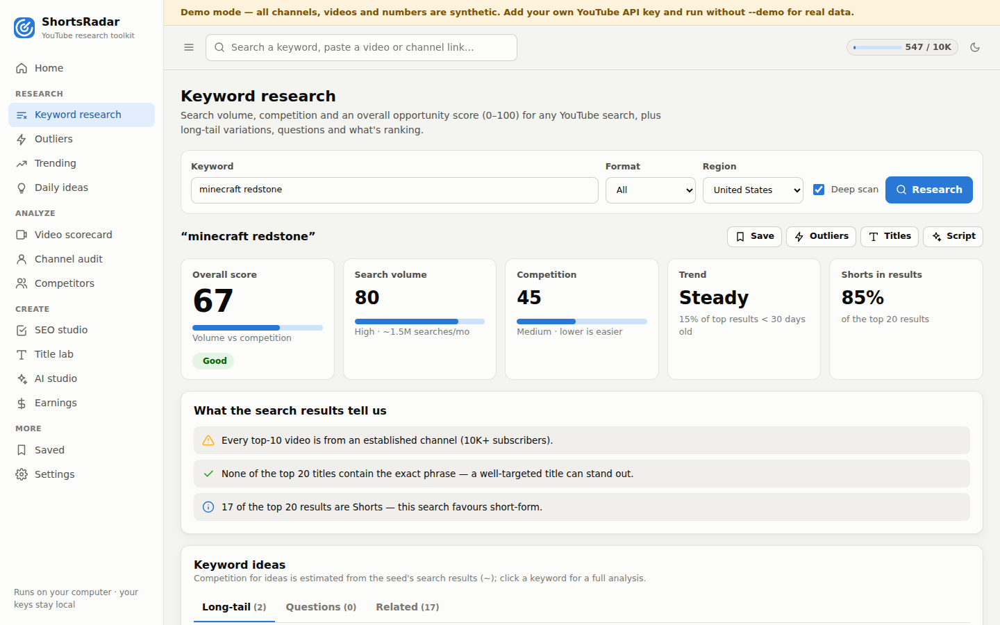
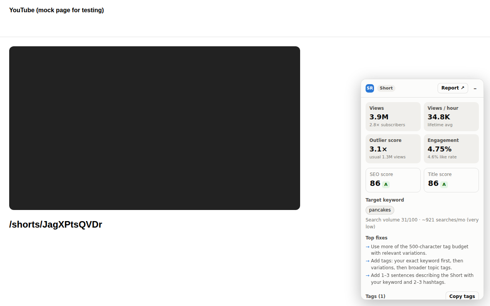

# ShortsRadar

**A free, self-hosted YouTube research toolkit — built as an open alternative to vidIQ, focused on YouTube Shorts (long-form works too).**

Keyword research with volume/competition/overall scores, an outlier finder, video scorecards with views-per-hour and SEO audits, channel audits, competitor tracking, trending, tag/title/SEO tools, an AI studio for hooks and Shorts scripts, and a Chrome extension that shows the stats right on YouTube. It runs on your own computer, costs nothing, and your API keys never leave your machine.



> Screenshots use the built-in **demo mode** (synthetic channels and numbers). Thumbnails show as grey placeholders there because demo videos don't exist on YouTube.

---

## What you get

| vidIQ feature | ShortsRadar | Needs |
|---|---|---|
| Keyword research: volume, competition, overall score, related keywords, questions | **Keyword research** — 0–100 scores, ~monthly searches, long-tail variations, questions, related keywords, top-ranking videos, tags & title phrases they use | Volume: nothing. Competition: free YouTube API key |
| Outliers (breakout videos) | **Outlier finder** — views ÷ the channel's median for the same format (Shorts vs Shorts), filters by date, size, score | API key |
| Video scorecard / VPH | **Video scorecard** — views/hour (lifetime + tracked), engagement, outlier score, SEO audit, title score, tags (copy), tag rankings, earnings | API key (a limited keyless mode exists) |
| Channel audit / best time to post | **Channel audit** — Shorts vs long-form, cadence, best day & time window, best video lengths, title words that win, recommendations | API key |
| Competitors | **Competitors** — track channels, breakout alerts, real views/hour from hourly snapshots | Free (RSS); API as a fallback |
| Trending / trend alerts | **Trending** — official trending chart per region/category, and "hot in my niche" ranked by views/hour | API key |
| SEO score, tag generator, title generator & score | **SEO studio, Title lab, tag generator** — live SEO checklist, CTR title score with explanations, tags within the 500-char limit, hashtags | Free |
| Daily ideas | **Daily ideas** — outliers in your niches + real searches worth answering | API key for outliers |
| AI coach / script / titles / descriptions | **AI studio** — hooks, Shorts scripts, titles, descriptions, tags, ideas | Claude key — or free templates / copy-paste prompt |
| Earnings estimates | **Earnings calculator** — category RPM × audience country, Shorts vs long-form | Free |
| Browser extension | **Chrome extension** — stats panel on watch, Shorts and search pages | App running |

---

## Quick start (about 5 minutes)

1. **Install Python 3.9 or newer** from [python.org/downloads](https://www.python.org/downloads/).
   *Windows:* tick **"Add python.exe to PATH"** in the installer.
2. **Get this project**: on GitHub press **Code → Download ZIP** and unzip it (or `git clone` it).
3. **Start it**
   - Windows: double-click **`start.bat`**
   - macOS / Linux: run `./start.sh` (or `python3 run.py`) in the project folder

   Your browser opens **http://127.0.0.1:8765**. Keep the window open while you use it; press `Ctrl+C` to stop.
4. **Add your free YouTube API key** in **Settings** (steps below). Keyword volume, title/SEO scores, tags, templates and competitor tracking already work without it.

Want to look around first? Run **`python run.py --demo`** — everything works on synthetic data, no key needed (it uses a separate data folder, so it never mixes with your real data).

No other installs are required: ShortsRadar uses only Python's standard library.

---

## Get a free YouTube Data API key

1. Open [Google Cloud Console](https://console.cloud.google.com/projectcreate) and create a project (any name). No billing account is needed.
2. Open [YouTube Data API v3](https://console.cloud.google.com/apis/library/youtube.googleapis.com) and click **Enable**.
3. Go to [Credentials](https://console.cloud.google.com/apis/credentials) → **Create credentials → API key**.
4. Recommended: edit the key → **API restrictions → YouTube Data API v3**.
5. Paste it into ShortsRadar → **Settings** → **Save & test key**.

The key gives you **10,000 quota units per day**, free. Results are cached, so repeating a search is free for hours.

| Action | Quota cost |
|---|---|
| Keyword research | ~102 units |
| Outlier search | ~120–200 units (deep scan 300+) |
| Video scorecard | 2–4 units |
| Channel audit | 3–10 units |
| Trending chart | 1–2 units |
| Tag rankings (optional) | 100 units per tag |
| Competitor tracking, autocomplete, SEO/title scores, templates | free |

Today's usage is shown at the top of the dashboard and in Settings. The quota resets at midnight Pacific Time.

---

## Optional: Claude for the AI studio

The AI studio (hooks, Shorts scripts, titles, descriptions, tags, ideas) works three ways:

- **Claude** — best results. Needs Python 3.10+ and:
  ```bash
  pip install "anthropic>=1.8"
  ```
  then paste an API key from [platform.claude.com](https://platform.claude.com/settings/keys) into **Settings**. Default model: **Claude Opus 5** at *medium* effort (both adjustable in Settings). Requests use Anthropic's server-side refusal fallback (`fallbacks: "default"`) so a request that trips a safety classifier is retried on the recommended fallback model instead of failing.
- **Free templates** — proven title/hook/script formats filled with your topic, scored and ranked.
- **Copy prompt** — a ready-made prompt you paste into the free [Claude.ai](https://claude.ai) chat.

---

## Chrome extension (stats on YouTube, like vidIQ)



1. Open `chrome://extensions` in Chrome (or Edge/Brave).
2. Turn on **Developer mode** (top right).
3. Click **Load unpacked** and select this project's **`extension`** folder.
4. Keep ShortsRadar running, then open any YouTube video, Short or search page.

The panel shows views, views/hour, outlier score, engagement, SEO and title scores, the target keyword's search volume, top fixes and the tags (one-click copy). On search pages it scores the search term. It follows YouTube's navigation (including swiping through Shorts), matches YouTube's dark theme, and can be minimized. If you run ShortsRadar on another port, set it in the extension's popup.

The extension only talks to the ShortsRadar app on your own computer (`127.0.0.1`), and can only call three read-only endpoints.

---

## Command line (for automation)

Every feature is also a command. Add `--json` to get machine-readable output for your Shorts pipeline.

```bash
python run.py keyword "minecraft redstone" --format short          # scores + related keywords
python run.py outliers "ai tools" --format short --within week --json > outliers.json
python run.py outliers --channel @SomeCompetitor --within month     # a channel's breakout videos
python run.py video https://youtube.com/shorts/VIDEO_ID             # scorecard + SEO audit
python run.py channel @YourChannel                                  # audit + recommendations
python run.py trending --region US --format short                   # trending chart
python run.py trending --keyword "cooking hacks" --hours 72         # hot in a niche
python run.py tags "minecraft redstone" --title "My Redstone Door"  # tags + hashtags (≤500 chars)
python run.py title "I Tried Redstone for 24 Hours" "redstone video" --keyword "minecraft redstone"
python run.py seo --title "..." --description-file desc.txt --tags "a, b, c" --keyword "..."
python run.py ideas "minecraft redstone" "cooking hacks"
python run.py ai script "hidden redstone door" --seconds 35         # uses Claude or templates
python run.py competitors add @Channel1 @Channel2 && python run.py competitors feed
python run.py earnings 2000000 --category Gaming --format short
python run.py quota
python run.py config set youtube_api_key YOUR_KEY
```

(If you installed it with `pip install .`, the same commands work as `shortsradar ...`.)

---

## How the numbers work

All scores are **estimates built from public data** — the same kind of signals vidIQ uses, but without vidIQ's private datasets. Treat them as a compass for comparing ideas, not exact counts.

**Search volume (0–100, plus ~monthly searches).** YouTube's search autocomplete ranks completions by popularity. ShortsRadar walks a keyword prefix by prefix ("suggestion chain"): popular searches appear after typing a letter or two, niche ones only once typed almost completely, nonsense never. At each step it estimates what share of the searches under that prefix continue toward your keyword (from the ranks of the suggestions), then reads the keyword's own rank. With an API key, it's blended 75/25 with how many views per day the ranking videos get. On a reference set of 25 keywords the model ranks keyword pairs in the same order as reference volumes ~88% of the time, with a typical error of ~4× on the absolute number. Re-run the check any time: `python scripts/calibrate_volume.py`.

**Competition (0–100).** From the top 20 search results: how many titles/tags explicitly target the phrase, the size of the ranking channels, the views of the top 10, and the share from 1M+ subscriber channels. Related keywords get a rougher estimate (marked `~`) reusing the seed's results; click one for a full analysis.

**Overall (0–100).** A weighted geometric blend of volume and (100 − competition): it's only high when people search for it *and* you can realistically rank.

**Outlier score (×).** A video's views ÷ the median views of the same channel's recent uploads **of the same format** (Shorts vs Shorts via YouTube's Shorts-only upload playlist), ignoring uploads younger than 3 days. 5× = five times what that channel usually gets.

**Views per hour.** Lifetime average (views ÷ hours since upload), plus real recent VPH once ShortsRadar has seen a video at least twice (every lookup and every competitor refresh stores a snapshot).

**SEO score.** A weighted checklist: keyword in title (and near the start), description length, keyword in the first 150 characters, tags (count, 500-char budget, keyword as first tag, relevance), the keyword in title + description + tags, hashtags (YouTube ignores all of them past 15), chapters for long-form, calls to action, captions, language — each with a fix.

**Title score.** An explainable click-through heuristic: length, numbers and specifics, curiosity gaps, direct address, proven formats ("I tried…", timeframes, stakes, comparisons, POV), keyword placement, and penalties for ALL CAPS, emoji/punctuation spam, vague openers and hype overload. Every point is listed so you can see why.

**Earnings.** Category RPM × audience-country multiplier, with a separate (much lower) Shorts RPM. Shown as a low/likely/high range.

---

## Privacy & data

- Everything runs locally; the dashboard only listens on `127.0.0.1` and rejects requests from other websites.
- Settings (including API keys) are stored in `~/.shortsradar/config.json` (owner-only permissions); cached data and history in `~/.shortsradar/shortsradar.db`. Set `SHORTSRADAR_HOME` to use another folder. You can also provide keys via the `YOUTUBE_API_KEY` / `ANTHROPIC_API_KEY` environment variables.
- Stored YouTube statistics older than 30 days are deleted automatically, in line with YouTube API data policies.

---

## Limitations

- Estimates are not vidIQ's numbers: vidIQ also uses private clickstream and Google Ads data. Volumes from autocomplete are best for *comparing* keywords.
- Private analytics of your own channel (retention, traffic sources, impressions CTR) need YouTube Analytics OAuth, which isn't included yet — the channel audit uses public data.
- YouTube's RSS feeds sometimes go down for hours (they answer 404 for every channel). Competitor tracking then falls back to the API (2 units per channel refresh) if you have a key.
- Autocomplete is an unofficial endpoint. ShortsRadar caches results for 3 days and rate-limits itself; if Google throttles it, keyword volume pauses briefly.

---

## Troubleshooting

| Problem | Fix |
|---|---|
| "Your YouTube API key is not valid" | Re-copy the key; check it isn't restricted to another API or to specific websites/IPs. |
| "YouTube Data API v3 is not enabled" | Enable it for the key's project (step 2 above). |
| "quota is used up" | Wait for the reset (midnight Pacific) — cached results still work. |
| Port 8765 is busy | `python run.py --port 8800` (and set the same port in the extension popup). |
| Extension says "ShortsRadar isn't running" | Start the app, then reload the YouTube tab. |
| Claude errors | Check the key in Settings, `pip install "anthropic>=1.8"`, and Python 3.10+. |

---

## For developers

```
shortsradar/        Python package (standard library only)
  keywords.py       volume model, competition, research
  outliers.py       channel-relative outlier scores
  channels.py       channel audit      scorecard.py   video scorecard
  competitors.py    RSS/API tracking   trending.py    charts & niche VPH
  seo.py titles.py tags.py earnings.py ideas.py ai.py
  youtube.py        Data API v3 client (caching, quota, errors)
  suggest.py rss.py resolve.py        autocomplete, feeds, URL/handle parsing
  server.py cli.py  web dashboard/JSON API and command line
  demo.py           fake YouTube backend used by --demo and the tests
  web/              dashboard (vanilla JS, no build step)
extension/          Chrome extension (Manifest V3)
tests/              unit + integration tests; tests/ui/*.mjs browser tests
scripts/            calibrate_volume.py
```

```bash
python -m unittest discover -s tests -t .                 # 58 tests, no network needed
SHORTSRADAR_LIVE=1 python -m unittest tests.test_live     # live checks against YouTube
python run.py --demo --no-browser &                       # then, with Playwright installed:
node tests/ui/smoke.mjs http://127.0.0.1:8765 screenshots
node tests/ui/extension.mjs http://127.0.0.1:8765 screenshots
```

---

ShortsRadar is an independent project. It is not affiliated with, endorsed by, or connected to vidIQ, YouTube or Google. It uses the official YouTube Data API v3 under Google's terms, plus public YouTube autocomplete, RSS and oEmbed endpoints.
